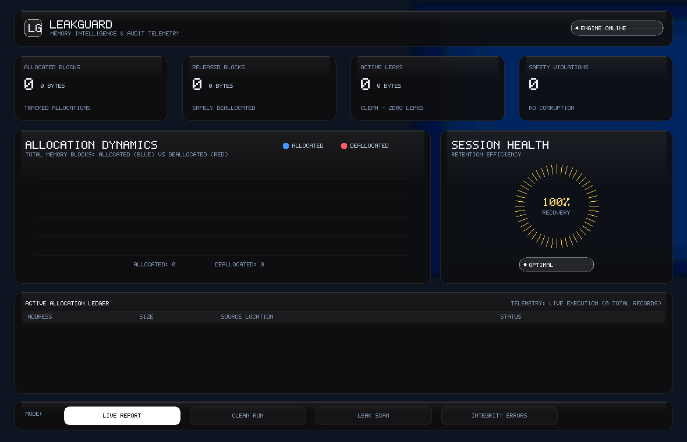

# LeakGuard — Memory Leak Detection Tool

LeakGuard is an educational C++ memory tracking project with a custom hash table, linked-list reporting, allocation/deallocation hooks, and an SDL2 graphical dashboard written in C.

## Features

- Records allocation address, byte count, source file, and line.
- Uses a fixed custom hash table with separate chaining for average constant-time address lookup.
- Keeps a singly linked list for complete report traversal.
- Reports active leaks, totals, repeated deallocation attempts, and unknown-address frees.
- Includes a C + SDL2 dashboard with a two-bar chart showing actual total allocated and deallocated blocks, plus three interactive demo scenarios (`1`–`3`).

## Dashboard preview

The chart compares total allocated blocks (blue) with total deallocated blocks (red). These bars show totals for the selected live report or demo scenario, not time intervals.


- Includes focused checks for hash lookup and free validation.

## Build and run (macOS with SDL2)

Install SDL2 with Homebrew if needed: `brew install sdl2`. Build a test program with the LeakGuard implementation, then run it:

```sh
clang++ -std=c++17 -Wall -Wextra -pedantic test_dynamic_allocation.cpp MemoryLeakDetector.cpp -o test_dynamic_allocation
./test_dynamic_allocation
```

At normal program exit, LeakGuard writes `leakguard_report.csv`, compiles `LeakGuardGUI.c` into `leakguard_gui`, and launches the dashboard automatically. VS Code's Code Runner setting builds the active C++ source with the tracker; its shutdown hook builds and opens the GUI. The GUI needs SDL2 headers and libraries at `/opt/homebrew` or `/usr/local`.

## Platform note

The automatic report and GUI launcher currently uses macOS APIs. The tracker and dashboard are C++/C respectively, but Windows needs a platform-specific launcher before the same automatic run flow will build there.

## Use the tracker in a program

Include `LeakGuard.h` and allocate with `new`. The default `new` macro records the source location. Call `leakguardTracker().generateReport()` at a point where the report is useful. Define `LEAKGUARD_NO_MACRO` before including the header if source-location tagging is not wanted. The demo test intentionally uses the tracker API directly to test invalid and repeated free attempts without invoking undefined behavior by actually freeing invalid memory.

## Design notes and limitations

A repeated or unknown free is rejected by the explicit `MemoryTracker::recordDeallocation` API and counted in the report. The global delete hook avoids releasing an already-recorded pointer twice. Passing an arbitrary invalid pointer to the language-level `delete` operator is undefined behavior in C++; use the explicit tracker API to validate suspect addresses safely. The test includes one intentional leaked allocation to demonstrate the leak state. This is an educational process-wide hook, not a production performance profiler. Allocation hooks cover ordinary and array `new`/`delete`; over-aligned allocations are not intercepted yet.
## SDL2 Installation and Setup

### About SDL2

LeakGuard uses **SDL2 (Simple DirectMedia Layer 2)** to develop and run its graphical user interface (GUI).

SDL2 is an external library and is not included by default with C or C++ compilers. Therefore, users must download and configure SDL2 before building the graphical interface.

**Note:** SDL2 is required only for the graphical interface. The core memory leak detection engine can be compiled and executed independently without SDL2.

### 1. Windows Setup

Windows users need to download the SDL2 development package compatible with their compiler and system architecture.

**Download SDL2:**

- [Official SDL2 Releases](https://github.com/libsdl-org/SDL/releases)

**Installation Steps:**

1. Open the official SDL2 releases page.
2. Download the SDL2 development package for MinGW that matches your compiler architecture.
3. Extract the downloaded archive.
4. Configure the SDL2 include directory and library directory in your compiler.
5. Link the SDL2 libraries while compiling the GUI.
6. Copy `SDL2.dll` into the same directory as the generated GUI executable.

**Important:**
- Select the correct architecture (32-bit or 64-bit) according to your compiler.
- The SDL2 development package is required for compilation.
- The `SDL2.dll` runtime file is required when running a dynamically linked GUI executable.

### 2. macOS Setup

macOS users must also configure SDL2 before compiling the graphical interface.

**Official Installation Guide:**

- [SDL2 Installation Guide for macOS](https://wiki.libsdl.org/SDL2/README-macos)
- [SDL2 General Installation Guide](https://wiki.libsdl.org/SDL2/Installation)

**Installation Steps:**

1. Open the official SDL2 macOS installation guide.
2. Follow the instructions to download and install SDL2.
3. Configure the SDL2 header and library paths for your compiler.
4. Link the SDL2 library while compiling the GUI.
5. Ensure that the required SDL2 runtime library is available when executing the application.

### 3. Important Dependency Information

SDL2 is an external dependency used by the LeakGuard graphical interface.

Users should ensure that the required SDL2 development and runtime files are properly configured for their operating system.

The required SDL2 library files differ between Windows and macOS. Therefore, a package downloaded for one operating system cannot be directly used on another.

For users who want to distribute LeakGuard as a standalone application, the required SDL2 runtime dependencies can be bundled with the application.

### 4. Project Components

| Component | SDL2 Required? |
|---|---|
| Memory tracking engine | No |
| Memory allocation and deallocation tracking | No |
| Memory leak detection | No |
| CSV report generation | No |
| Graphical User Interface (GUI) | Yes |

**Note:** LeakGuard currently uses SDL2 for its graphical interface. Make sure to download SDL2 version 2.x rather than SDL3, as they have different APIs.
